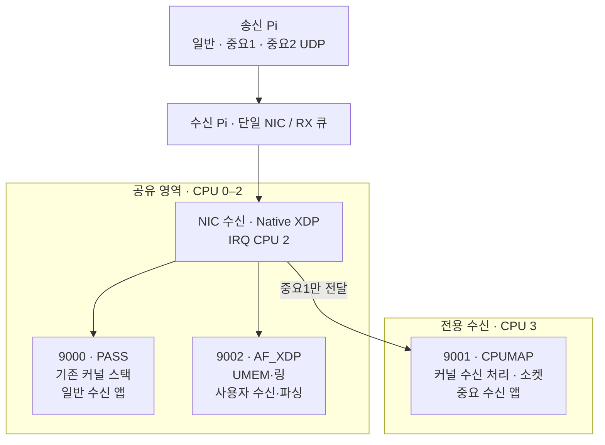
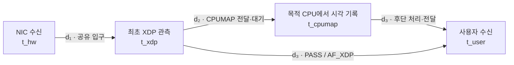
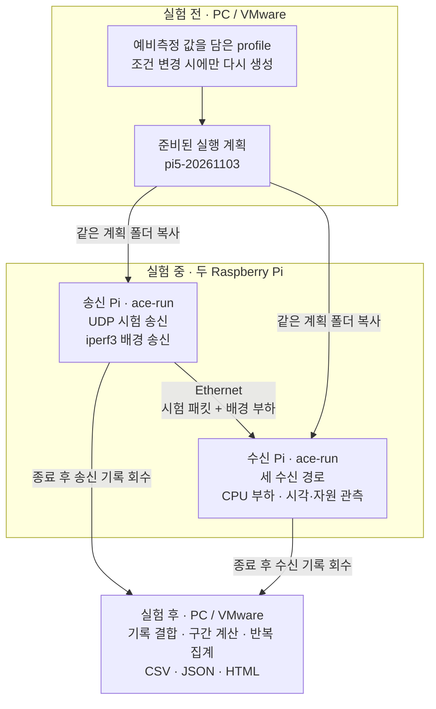

# Deterministic Mixed-Criticality Packet Processing on Embedded PREEMPT_RT Linux with Driver-Level BPF

**하나의 수신 NIC에서 일반 통신과 중요 통신을 함께 처리하기 위한 세 경로 아키텍처.**

Raspberry Pi 5의 PREEMPT_RT Linux와 macb Native XDP를 기반으로,
기존 Linux 소켓 경로 **PASS**, 사용자 공간 직접 수신 **AF_XDP**,
중요 흐름을 전용 CPU에서 처리하는 **CPUMAP**을 단계적으로 구성한다.
일반 소켓과 AF_XDP 구성은 CPU 0~3 전체를 공유한다. CPUMAP 중요 흐름을 사용할 때
CPU 3을 전용 수신 영역으로 분리하여 커널 처리부터 사용자 수신까지 수행한다.
드라이버 포팅부터 송수신 프로그램, 부하 생성, 시각 기록, 반복 실행과 사후 분석까지 포함한다.

> **기능을 처리하는 위치와 자원의 공유 구조를 바꾸면, 부하의 영향이 나타나는 구간도 달라진다.**
> 일반 Linux 소켓 처리에 AF_XDP를 추가하면 얼마나 빨라지는가?
> 중요 흐름만 전용 CPU로 분리하면 CPU·네트워크 부하 속에서 얼마나 빠르고 안정적으로
> 처리되는가? 네 관측점으로 그 결과가 나타난 구간을 설명한다.

[수신 구조](#1-수신-pi에서-패킷은-어디로-가는가) ·
[비교 실험](#2-어떤-구성을-비교하는가) ·
[지연 측정](#4-시간은-어디서-재는가) ·
[실행 도구 이해](#5-실험-도구는-무슨-일을-하는가) ·
[실행 순서](#6-실제로-실험을-진행하는-순서) ·
[코드와 상세 문서](#7-코드와-상세-문서)

## 1. 수신 Pi에서 패킷은 어디로 가는가

송신 Pi가 세 종류의 UDP 시험 패킷을 보내면, 수신 Pi의 Native XDP가 **설정한 구성과
목적지 포트**에 따라 경로를 나눈다. 아래는 세 경로를 모두 사용하는 `mixed` 구성이다.



| 경로 | 기능을 처리하는 방식 | 이 경로에서 볼 것 |
|---|---|---|
| **PASS** | 공유 영역에서 기존 커널 IP/UDP 스택과 표준 소켓을 사용한다. | 일반 Linux 수신의 지연·처리량 |
| **AF_XDP** | 같은 공유 영역에서 커널 IP/UDP 스택을 우회하고 사용자 프로그램이 필요한 처리를 맡는다. 현재는 `XDP_COPY` 방식이다. | 스택 우회에 따른 지연 변화와 공유 부하의 영향 |
| **CPUMAP** | 중요 흐름을 CPU 3으로 넘겨 커널 스택과 수신 앱을 그곳에서 실행한다. | 전달 비용을 포함한 총지연과 전용 수신 영역의 부하 대응 효과 |

PASS·AF_XDP·일반 Linux 프로그램은 해당 구성의 **일반 실행 영역 전체**를 공유한다.
all-pass·pass-xsk에서는 CPU 0·1·2·3, 위 mixed 구성에서는 CPU 0·1·2다.
Linux가 이 범위에서 실행 CPU를 선택한다. NIC IRQ의 CPU 2도 일반 앱과 부하가
함께 실행되는 공유 영역에 포함된다.

**XDP**는 패킷이 일반 커널 네트워크 스택에 들어가기 전, 드라이버 수신 경로에서
프로그램을 실행하는 지점이다. **PREEMPT_RT**는 실행 선점과 스케줄링을 위한 공통 기반이며,
이 프로젝트는 그 위에서 패킷 처리 위치와 CPU 공유 방식을 바꿔 본다.
프로젝트가 지정한 시험 흐름 외의 트래픽은 일반 커널 경로로 전달한다.

## 2. 어떤 구성을 비교하는가

**경로**는 패킷 하나가 지나는 방식이고, **구성(mode)**은 세 흐름에 어떤 경로를 배정했는지다.

| 비교 구성 | 일반 · 9000 | 중요1 · 9001 | 중요2 · 9002 | 수신 실행 영역 |
|---|---|---|---|---|
| **① 일반 소켓 처리** `all-pass` | PASS | PASS | PASS | 세 수신 앱 모두 CPU 0·1·2·3 공유 |
| **② AF_XDP 추가** `pass-xsk` | PASS | PASS | AF_XDP | 세 수신 앱 모두 CPU 0·1·2·3 공유 |
| **③ 중요 수신 분리** `mixed` | PASS | CPUMAP | AF_XDP | 중요1만 CPU 3, 나머지는 CPU 0·1·2 공유 |

- **① → ②:** 같은 공유 영역에서 중요2를 AF_XDP로 받았을 때의 속도와 공존 성능을 본다.
- **② → ③:** 중요1의 커널 처리와 수신을 CPU 3으로 분리했을 때의 지연·기한 초과·손실을 본다.
- **① → ③:** 세 경로 구조 전체가 일반 처리량과 두 중요 흐름에 미친 효과를 함께 본다.

세 구성은 같은 트래픽·부하 조건을 사용한다. 수신 앱의 정책은 모두 **OTHER/0**으로
맞춘다. all-pass에서도 동일한 XDP 계측을 거치며, 세 흐름 모두 기존 커널 스택으로 전달한다.
**총 CPU는 네 개로 같고, 네 개를 함께 쓰는 구성과 세 개 공유 + 한 개 전용 구성을 비교한다.**
실행기는 mixed의 중요1을 시작할 때 CPU 3을 예약하고, 종료 후 일반 실행 영역에 반환한다.
CPUMAP 중요1이 꺼진 단독 PASS·AF_XDP 측정도 CPU 0~3 전체를 사용한다.

송신 Pi의 CPU 배치는 시험 패킷의 주기를 유지하기 위한 별도 설정이다.
세 송신기는 CPU 0/1/2, 배경 송신기는 CPU 3에 두며 중요 송신기는 FIFO 80을 사용한다.

## 3. 부하가 증가할 때 세 구성은 어떻게 달라지는가

일반·중요1·중요2의 세 계측 흐름은 각각 **1,000 PPS**로 고정한다. 시험 패킷은 **UDP payload 96B**
(32B 실험 헤더 + 64B 데이터), 중요 흐름의 비교 기한은 **NIC 수신부터 100µs**다.
각 구성·조건을 **60초 송신 · 5회 반복**으로 측정한다.

| 본실험 조건 | CPU 연산 부하 | iperf3 배경 네트워크 부하 |
|---|---|---|
| **기본 상태** | 끔 | 끔 |
| **CPU 경합** | 켬 | 끔 |
| **네트워크 부하** | 끔 | 855 Mbps |
| **복합 부하** | 켬 | 855 Mbps |

각 조건에서 세 수신 구성을 비교해 CPU 경쟁과 배경 트래픽이 어느 구간과 흐름에
영향을 주는지 본다. iperf3의 UDP/5201 트래픽도 PASS로 일반 커널 스택에서 처리한다.
따라서 실제 일반 통신량은 **9000번 계측 흐름 + iperf3 배경 트래픽**이며,
배경 부하를 켜면 일반 통신량이 증가한다.

CPU 부하는 **같은 세 워커**가 일반 실행 영역을 함께 사용하도록 만든다.
각 워커의 강도는 0%/100%이며 all-pass·pass-xsk는 CPU 0~3, mixed는 CPU 0~2에서
Linux가 스케줄링한다. 네 부하 조건에서 세 구성을 각각 측정한다.

먼저 세 경로를 하나씩 측정하고, 위 네 부하 조건에서 세 구성을 비교한다.

| 실행 묶음 | 계산 | 횟수 |
|---|---|---:|
| 경로별 단독 | PASS는 all-pass, CPUMAP은 mixed, AF_XDP는 pass-xsk에서 하나씩 × 5회 | 15 |
| 부하 본실험 | 4조건 × ①/②/③ × 5회 | 60 |
| **전체** | **단독 15회 + 본실험 60회** | **75** |

실행 계획은 단독 3개와 본실험 4개, **7개 조건 파일**로 구성한다.
두 Pi의 예비측정 값을 적용한 [실행 계획](experiment/design/pi5-20261103)이 준비되어 있다.
배경 부하는 **855 Mbps**, 송신 완료 후 추가 대기는 **0 ms**, 수신기 drain은 **100 ms**다.
75회는 이 계획으로 수행할 단독·본실험 횟수이며, 예비측정 기록은
[Pi 예비측정 보고서](experiment/validation/pilot-20261103.md)에 별도로 정리한다.
자세한 조건과 적용 위치는 [실험 준비 안내](experiment/design/배포전_준비사항.md)에 있다.

## 4. 시간은 어디서 재는가

측정 대상은 **수신 Pi의 NIC 수신 → 사용자 프로그램의 패킷 수신**이다.
패킷 식별자 `flow_id + sequence`로 아래 시각을 연결한다.



CPUMAP의 목적 CPU에는 **계측용 XDP 프로그램**을 부착해 도착 후 시각을 기록한다.
사용자 수신 시각은 UDP의 `recvmsg` 반환 직후 또는 AF_XDP 패킷 파싱 직전에 기록한다.

$$L_{\mathrm{total}} = d_1 + d_2 + d_3$$

| 구간 | 포함하는 시간 | 분석 필드 |
|---|---|---|
| **d₁ · 공유 입구** | NIC 수신부터 최초 XDP 관측까지 | `xdp-hw` |
| **d₂ · CPU 전달·대기** | 최초 XDP부터 CPUMAP 목적 CPU의 관측까지. PASS·AF_XDP는 0 | `cpumap-xdp` |
| **d₃ · 후단 처리·전달** | 마지막 XDP 관측부터 사용자 수신까지 | CPUMAP: `user-cpumap` / PASS·AF_XDP: `user-xdp` |

**후단 비교는 PASS·AF_XDP의 d₃와 CPUMAP의 d₂+d₃를 나란히 본다.**
그래야 최초 XDP부터 사용자 수신까지 같은 범위에서 전달 비용과 처리 변화를 읽을 수 있다.
PASS의 소켓 큐 대기·앱 실행과 AF_XDP의 링 전달·사용자 수신 시간은 각 경로의 d₃에 포함된다.

NIC의 HW 시계(PHC)와 시스템의 경과 시간 시계(MONOTONIC)는 실험 전후에 보정한다.
패킷별 보정 HW 시각 하나를 d₁과 총지연에 재사용하고 구간 합을 검사한다.
총지연 p99와 기한 초과율은 **같은 패킷의 총지연 분포**에서 계산한다.

결과는 중요 흐름의 **총지연·100µs 초과율·손실**, 일반 흐름의 **수신 PPS·손실**,
**구간별 시간·CPU 사용률·NIC 처리량**을 함께 제시한다.
CPU 사용률과 NIC 처리량은 패킷 기록에서 얻은 같은 수신 측정 구간으로 집계한다.
입구의 남은 시간 예산은
`d₁ ≤ D − (d₂+d₃)`로 읽고, 입구 지연 개선 방향은 후속 제언으로 연결한다.

## 5. 실험 도구는 무슨 일을 하는가

**사람이 조건을 정하고, 두 Pi가 실험을 수행하고, PC에서 결과를 읽는다.**



그림은 설정 파일·시험 트래픽·측정 기록의 흐름이다. 두 Pi는 같은 네트워크에서
준비·시작·종료 제어 메시지도 양방향으로 주고받는다.

| 평소에 할 일 | 담당 도구 | 입력 → 출력 |
|---|---|---|
| **조건을 바꿀 때 계획을 만든다** | `build_plan.py` | 선택값을 담은 profile → 조건별 `.conf`와 실행표 |
| **조건을 차례로 실행한다** | `run_matrix.sh` | 실행표 → 조건별 `ace-run` 호출 |
| **한 번의 실험을 진행한다** | `ace-run` | 조건 파일 → 준비·송수신·부하·종료·기록 저장 |
| **기록을 합쳐 결과를 본다** | `run_matrix.sh collect` → `analysis/` | 두 Pi의 기록 → 패킷별 CSV, 집계 JSON, HTML |

여기서 **“계획 생성기”는 정한 값을 7개의 조건 파일로 펼치는 프로그램**이다.
경로와 부하 값은 사람이 정한 조건표를 따른다. 실행표에는 구성별 반복 횟수와 순서가 담긴다.
현재 두 Pi에서는 저장소에 포함된 실행 계획을 바로 사용한다.

패킷 송수신·시각 기록은 **C/BPF**가 수행한다. Python은 계획 생성·조건 순서 관리·사후 분석을
맡는다. 조건 순서 관리 프로그램은 한 실험이 도는 동안 C 실행기의 완료를 기다린다.
실험 중 VMware의 원격 제어 없이 두 Pi가 직접 진행한다.

**한 번의 실행 안에서는 다음 순서를 밟는다.**

```text
구성에 맞는 CPU 영역 적용 · 수신 경로·송수신기 준비
    → 부하 시작 · 5초 안정화
    → 수신 시계 사전 보정
    → 60초 조건의 시험 패킷 송신
    → 송신 종료 · 잔여 패킷 수신
    → 기록 저장 · 사후 보정 · 부하 종료
    → CPU 3 예약 해제 · CPU 0~3 공유 복원
```

패킷 기록은 메모리에 모으고 종료 후 저장한다. CPU·NIC 관측은 C 프로그램이
1초 간격과 종료 시점에 tmpfs에 남긴 뒤 회수한다.
실행기는 수신 앱의 CPU 허용 집합·정책·우선순위, IRQ·CPUMAP 스레드 설정과
CPU 3 예약·반환 상태도 기록한다.

## 6. 실제로 실험을 진행하는 순서

### ① 두 Pi의 실행 환경을 준비한다

수신 Pi는 [macb Native XDP·PREEMPT_RT 패치](patches/macb-xdp-20260910/README.md)를
적용한 커널을 사용한다. 두 Pi에 같은 저장소 버전을 준비하고 빌드한다.

```bash
sudo apt install build-essential clang llvm bpftool libbpf-dev libxdp-dev \
  pkg-config python3 stress-ng iperf3 sysstat
make
```

`make test`는 빌드·분석·루프백 회귀 검사를 실행한다.
실제 수신 환경과 초기 동작 기록은 [측정 돌리는 법](측정돌리는법.md)에 있다.
수신 Pi는 CPU 0~3을 일반 작업이 사용할 수 있는 상태로 준비한다.
실행기가 cgroup v2로 mixed의 CPU 3을 예약하고 실행 후 반환한다.
다음 명령으로 전체 CPU와 수신 환경을 검사한다.

```bash
bash monitor/check_cpu_partition.sh eth0 0,1,2,3 3
```

이전에 CPU 3의 고정 부팅 격리를 적용했다면 해당 설정을 제거하고 재부팅한다.
장치 준비와 검사 항목은 [실험 준비 안내](experiment/design/배포전_준비사항.md)를 따른다.

### ② 예비측정 값을 적용한 실행 계획을 사용한다

[Pi 설정값](experiment/design/profile.pi5-20261103.json)과
[실행 계획 폴더](experiment/design/pi5-20261103)를 저장소에 포함했다.
두 Pi에 같은 저장소 버전을 준비하면 아래 계획을 그대로 실행할 수 있다.

| 적용값 | 설정과 근거 |
|---|---|
| 수신 시험망 IP | `receiver_address=192.168.10.10` |
| 배경 UDP 부하 | `network_high_bps=855000000` — 기준 950 Mbps의 90% |
| 송신 완료 후 추가 대기 | `settle_ms=0` |
| 수신기 종료 전 drain | `drain_ms=100` |

측정 방법과 선택 근거는 [Pi 예비측정 보고서](experiment/validation/pilot-20261103.md)에 있다.

전체 CPU 집합 `receiver_shared_cpus=[0,1,2,3]`와 중요 수신 CPU `receiver_cpumap_cpu=3`은
profile에 담겨 있다. 실행기가 구성에 맞춰 일반 영역을 네 개 또는 세 개로 적용한다.
수신 앱은 모두 OTHER/0을 사용하고 실제 배치를 준비 직후 검사한다.

### ③ 두 Pi에서 같은 계획 폴더를 사용한다

준비된 계획의 구성은 다음과 같다.

```text
experiment/design/pi5-20261103/
  matrix.csv       사람이 보는 조건표
  plan.json        실행 횟수 요약: 75회
  profile.json     이번에 선택한 값
  execution.json   실행 순서·구성·반복 수·설정 해시
  single-*.conf    경로별 단독 조건
  main-*.conf      CPU·네트워크 부하 4조건: 각 조건에서 세 구성 비교
```

**조건을 바꿀 때만** profile을 수정하고 새 계획을 생성한다.
새 계획은 폴더 전체를 같은 내용으로 두 Pi에 복사한다.

```bash
python3 experiment/design/build_plan.py \
  --profile /path/to/edited-profile.json --output /path/to/new-plan
```

### ④ 수신 Pi에서 먼저 시작하고 송신 Pi를 시작한다

```bash
# 수신 Pi
sudo ./experiment/run_matrix.sh receiver --plan-dir experiment/design/pi5-20261103

# 송신 Pi
sudo ./experiment/run_matrix.sh sender --plan-dir experiment/design/pi5-20261103
```

각 Pi가 자기 장치에서 실행한다. 시작 전 설정 해시·실행 조건을 검사하고,
조건별 모드를 교대·순환하며 반복한다. 실패하면 다음 조건으로 넘어가지 않는다.
실행 결과는 각 Pi의 `results/experiment/<조건명>/<receiver 또는 sender>/runs/`에 쌓인다.
새 캠페인은 양쪽 Pi의 기존 `results/experiment`를 다른 이름으로 보관한 뒤 시작한다.

### ⑤ 두 Pi의 기록을 모아 분석한다

두 장치의 `results/experiment`를 각각 분석 장비로 복사한다.
아래의 `rx-results`, `tx-results`는 복사한 각 `experiment` 디렉터리다.
Linux에서는 다음 명령으로 실행 계획 전체를 수집·분석한다.

```bash
./experiment/run_matrix.sh collect --plan-dir experiment/design/pi5-20261103 \
  --receiver-root /path/to/rx-results --sender-root /path/to/tx-results \
  --output /path/to/new-collected
```

| 보고 싶은 것 | 결과 파일 |
|---|---|
| 조건별 지연·손실·CPU 사용률·NIC 처리량 | `new-collected/analysis-report/report.html` |
| 집계값으로 추가 그래프 만들기 | `new-collected/analysis-report/report.json` |
| 개별 패킷의 네 시각과 d₁·d₂·d₃ | 각 run의 `analysis/joined.csv` |
| run별 지연 분포 통계·구간 합 검사 | 각 run의 `analysis/summary.json` |

수집기는 구성별 실행 횟수와 설정 일치를 검사한다. 원시 기록을 보존하고,
불완전 실행과 손실도 보고서에 남긴다. Windows에서도 Python 분석기로 회수한 기록을
분석할 수 있다. 실행 방법과 분석 필드는 [분석 안내](analysis/README.md)에 있다.

## 7. 코드와 상세 문서

| 찾는 내용 | 위치 |
|---|---|
| Native XDP 분류·CPUMAP·AF_XDP와 수동 실행·복구 | [BPF/](BPF/README.md) |
| UDP 송수신기·PHC 보정·CPU 관측기 | [udp_socket/](udp_socket/README.md) |
| 한 번의 실험 제어와 전체 실행표 운영 | [experiment/](experiment/README.md) |
| 최신 조건·CPU 배치·예비시험 | [실험 준비 안내](experiment/design/배포전_준비사항.md) |
| CPU·네트워크 부하와 환경 기록 | [monitor/](monitor/README.md) |
| 기록 결합·구간 지연·반복 집계 | [analysis/](analysis/README.md) |
| 커널·드라이버 적용 | [macb 패치](patches/macb-xdp-20260910/README.md) |
| 포팅 경위와 초기 세 경로 동작 기록 | [드라이버 포팅 기록](드라이버%20포팅한%20그%20모든것을%20담아.md) · [측정 돌리는 법](측정돌리는법.md) |

드라이버·경로별 수신·자동 실행·분석 도구가 준비되어 있다.
두 Pi의 예비측정 값을 적용한 실행 계획을 준비했다.
다음 단계는 **준비된 계획으로 단독·본실험 75회 수행 → 결과 분석**이다.
