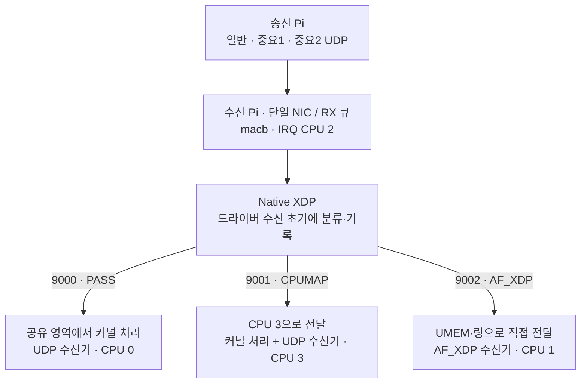
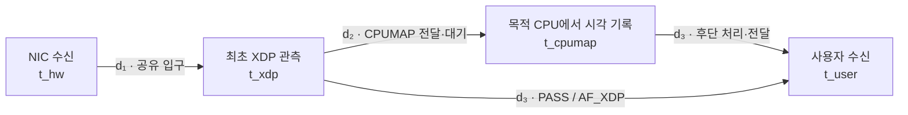
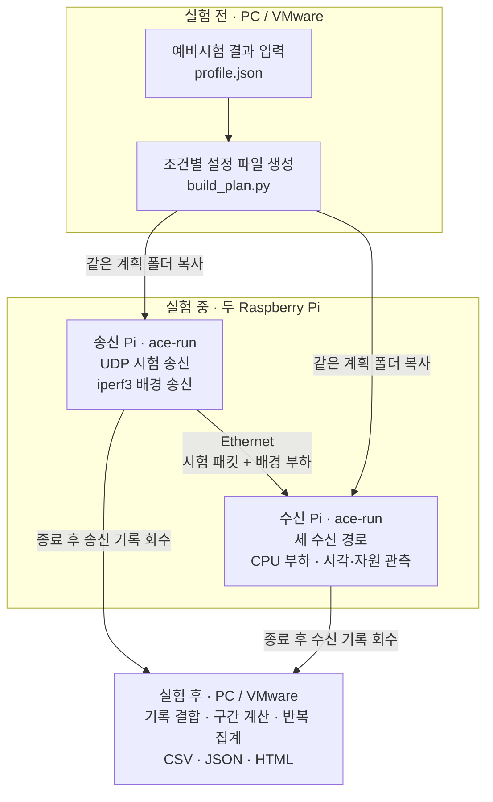

# Deterministic Mixed-Criticality Packet Processing on Embedded PREEMPT_RT Linux with Driver-Level BPF

**하나의 수신 NIC에서 일반 통신과 중요 통신을 함께 처리하기 위한 세 경로 아키텍처.**

Raspberry Pi 5의 PREEMPT_RT Linux와 macb Native XDP를 기반으로,
공유 커널 경로 **PASS**, 커널 처리 CPU를 분리하는 **CPUMAP**,
사용자 공간으로 직접 전달하는 **AF_XDP**를 함께 운용한다.
드라이버 포팅부터 송수신 프로그램, 부하 생성, 시각 기록, 반복 실행과 사후 분석까지 포함한다.

> **기능을 처리하는 위치와 자원의 공유 구조를 바꾸면, 부하의 영향이 나타나는 구간도 달라진다.**
> 일반 커널 경로와 직접 수신 경로가 공존할 때, 중요 흐름의 커널 처리까지 별도 CPU로
> 옮기면 어느 구간이 변하고 전체 공존 성능은 어떻게 달라지는가? 네 관측점으로 그 변화를 설명한다.

[수신 구조](#1-수신-pi에서-패킷은-어디로-가는가) ·
[비교 실험](#2-어떤-구성을-비교하는가) ·
[지연 측정](#4-시간은-어디서-재는가) ·
[실행 도구 이해](#5-실험-도구는-무슨-일을-하는가) ·
[실행 순서](#6-실제로-실험을-진행하는-순서) ·
[코드와 상세 문서](#7-코드와-상세-문서)

## 1. 수신 Pi에서 패킷은 어디로 가는가

송신 Pi가 세 종류의 UDP 시험 패킷을 보내면, 수신 Pi의 Native XDP가 **설정한 구성과
목적지 포트**에 따라 경로를 나눈다. 아래는 세 경로를 모두 사용하는 `mixed` 구성이다.



| 경로 | 기능을 처리하는 방식 | 이 경로에서 볼 것 |
|---|---|---|
| **PASS** | 기존 커널 IP/UDP 스택과 표준 소켓을 사용한다. | 일반 작업과 실행 자원을 공유할 때의 지연·처리량 |
| **CPUMAP** | 목적 CPU로 패킷을 넘긴 뒤 커널 스택과 표준 소켓을 사용한다. | CPU 전달 비용과 이후 커널 처리·수신 시간의 변화 |
| **AF_XDP** | 커널 IP/UDP 스택을 우회하고 사용자 프로그램이 필요한 처리를 맡는다. 현재는 `XDP_COPY` 방식이다. | 프레임 복사·링 전달·사용자 수신에 걸리는 시간 |

**XDP**는 패킷이 일반 커널 네트워크 스택에 들어가기 전, 드라이버 수신 경로에서
프로그램을 실행하는 지점이다. **PREEMPT_RT**는 실행 선점과 스케줄링을 위한 공통 기반이며,
이 프로젝트는 그 위에서 패킷 처리 위치와 CPU 공유 방식을 바꿔 본다.
프로젝트가 지정한 시험 흐름 외의 트래픽은 일반 커널 경로로 전달한다.

## 2. 어떤 구성을 비교하는가

**경로**는 패킷 하나가 지나는 방식이고, **구성(mode)**은 세 흐름에 어떤 경로를 배정했는지다.

| 비교 구성 | 일반 · 9000 | 중요1 · 9001 | 중요2 · 9002 | 중요1 수신기 CPU |
|---|---|---|---|---:|
| **① 공유 기준선** `all-pass` | PASS | PASS | PASS | 1 |
| **② 중간 대조** `pass-xsk` | PASS | PASS | AF_XDP | 3 |
| **③ 제안 구조** `mixed` | PASS | CPUMAP | AF_XDP | 3 |

- **① ↔ ③: 전체 구조의 효과.** 같은 입력과 부하에서 중요 흐름의 지연·기한 초과·손실과
  일반 흐름의 처리량·CPU 사용률을 함께 비교한다.
- **② ↔ ③: 커널 처리 이동의 효과.** 수신기 CPU·우선순위와 AF_XDP 배치를 유지하고,
  중요1에 CPUMAP 전달을 추가했을 때의 변화를 본다.

일반 수신기는 CPU 0, 중요2 수신기는 CPU 1에 둔다. 중요 송수신기는 FIFO 80,
일반 흐름과 배경 부하는 OTHER/0으로 시작하며, 전달 스레드 설정은 예비시험에서 점검한다.
송신 Pi에서는 세 송신기를 CPU 0/1/2, 배경 네트워크 송신기를 CPU 3에 배치한다.

## 3. 부하와 공유 위치를 어떻게 바꾸는가

중요 흐름 두 개는 각각 **1,000 PPS**를 유지한다. 시험 패킷은 **UDP payload 96B**
(32B 실험 헤더 + 64B 데이터), 중요 흐름의 비교 기한은 **NIC 수신부터 100µs**다.
각 구성·조건을 **60초 송신 · 5회 반복**으로 측정한다.

| 실험 | 바꾸는 것 | 결과에서 읽을 내용 |
|---|---|---|
| **A · 외부 부하** | CPU 0/100% × 배경 네트워크 0/고부하의 네 조건 | CPU 경쟁과 배경 트래픽이 어느 구간과 흐름에 영향을 주는가 |
| **B · 일반 통신 증가** | 일반 흐름 0/1,000/3,000/최고 PPS × CPU 0/100% | 일반 통신이 증가할 때 중요 통신의 시간 성능과 일반 처리량이 어떻게 변하는가 |
| **C · 실행 영역 공유** | 워커 위치 이동 또는 일반 수신기 이동을 각각 적용 | 중요 처리 CPU를 다른 작업과 공유할 때 무엇이 달라지는가 |

C의 기준은 **CPU 0·1·2에 부하 워커 3개**를 둔 mixed다. 아래 두 변경을 각각 비교한다.

| C의 배치 | CPU 0 | CPU 1 | CPU 2 | CPU 3 |
|---|---|---|---|---|
| 기준 | 부하 | 부하 | 부하·IRQ | 중요1 처리 |
| 워커 위치 이동 | 부하 | 워커 없음 | 부하·IRQ | 중요1 처리 + 부하 |
| 일반 수신기 이동 | 부하 | 부하 | 부하·IRQ | 중요1 처리 + 일반 수신기 |

워커 이동은 **3개·100%를 유지**하며 CPU 1의 워커만 CPU 3으로 옮긴다.
일반 수신기 이동에서는 워커를 원래 위치에 둔다.

**실행표는 조건 파일 15개, 실제 실행 135회다.**

| 실행 묶음 | 계산 | 횟수 |
|---|---|---:|
| 경로별 단독 | mixed에서 흐름 하나씩 3경로 × 5회 | 15 |
| A·B 주 비교 | 중복 제외 10조건 × ①/③ × 5회 | 100 |
| 중간 대조 | A의 무부하·복합부하에서 ② × 5회 | 10 |
| C 추가 | 워커 이동·수신기 이동을 ③에서 각각 5회 | 10 |
| **전체** | **단독 15회 + 본실험 120회** | **135** |

A와 B의 중복 두 조건, C의 기준, 중간 대조에서 비교할 mixed 결과는 재사용한다.
최고 일반 PPS와 배경 고부하 전송률은 예비측정으로 확정한다.
자세한 조건과 적용 위치는 [실험 준비 안내](experiment/design/배포전_준비사항.md)에 있다.

## 4. 시간은 어디서 재는가

측정 대상은 **수신 Pi의 NIC 수신 → 사용자 프로그램의 패킷 수신**이다.
패킷 식별자 `flow_id + sequence`로 아래 시각을 연결한다.



CPUMAP의 목적 CPU에는 **계측용 XDP 프로그램**을 부착해 도착 후 시각을 기록한다.
사용자 수신 시각은 UDP의 `recvmsg` 반환 직후 또는 AF_XDP 패킷 파싱 직전에 기록한다.

$$L_{\mathrm{total}} = d_1 + d_2 + d_3$$

| 구간 | 포함하는 시간 | 분석 필드 |
|---|---|---|
| **d₁ · 공유 입구** | NIC 수신부터 최초 XDP 관측까지 | `xdp-hw` |
| **d₂ · CPU 전달·대기** | 최초 XDP부터 CPUMAP 목적 CPU의 관측까지. PASS·AF_XDP는 0 | `cpumap-xdp` |
| **d₃ · 후단 처리·전달** | 마지막 XDP 관측부터 사용자 수신까지 | CPUMAP: `user-cpumap` / PASS·AF_XDP: `user-xdp` |

**후단 비교는 PASS·AF_XDP의 d₃와 CPUMAP의 d₂+d₃를 나란히 본다.**
그래야 최초 XDP부터 사용자 수신까지 같은 범위에서 전달 비용과 처리 변화를 읽을 수 있다.

NIC의 HW 시계(PHC)와 시스템의 경과 시간 시계(MONOTONIC)는 실험 전후에 보정한다.
패킷별 보정 HW 시각 하나를 d₁과 총지연에 재사용하고 구간 합을 검사한다.
총지연 p99와 기한 초과율은 **같은 패킷의 총지연 분포**에서 계산한다.

결과는 중요 흐름의 **총지연·100µs 초과율·손실**, 일반 흐름의 **수신 PPS·손실**,
**구간별 시간과 CPU 사용률**을 함께 제시한다. 입구의 남은 시간 예산은
`d₁ ≤ D − (d₂+d₃)`로 읽고, 입구 지연 개선 방향은 후속 제언으로 연결한다.

## 5. 실험 도구는 무슨 일을 하는가

**사람이 조건을 정하고, 두 Pi가 실험을 수행하고, PC에서 결과를 읽는다.**



그림은 설정 파일·시험 트래픽·측정 기록의 흐름이다. 두 Pi는 같은 네트워크에서
준비·시작·종료 제어 메시지도 양방향으로 주고받는다.

| 평소에 할 일 | 담당 도구 | 입력 → 출력 |
|---|---|---|
| **조건을 파일로 펼친다** | `build_plan.py` | 선택값을 담은 profile → 조건별 `.conf`와 실행표 |
| **조건을 차례로 실행한다** | `run_matrix.sh` | 실행표 → 조건별 `ace-run` 호출 |
| **한 번의 실험을 진행한다** | `ace-run` | 조건 파일 → 준비·송수신·부하·종료·기록 저장 |
| **기록을 합쳐 결과를 본다** | `run_matrix.sh collect` → `analysis/` | 두 Pi의 기록 → 패킷별 CSV, 집계 JSON, HTML |

여기서 **“계획 생성기”는 정한 값을 15개의 조건 파일로 펼치는 프로그램**이다.
경로와 부하 값은 사람이 정한 조건표를 따른다. 실행표에는 구성별 반복 횟수와 순서가 담긴다.

패킷 송수신·시각 기록은 **C/BPF**가 수행한다. Python은 계획 생성·조건 순서 관리·사후 분석을
맡는다. 조건 순서 관리 프로그램은 한 실험이 도는 동안 C 실행기의 완료를 기다린다.
실험 중 VMware의 원격 제어 없이 두 Pi가 직접 진행한다.

**한 번의 실행 안에서는 다음 순서를 밟는다.**

```text
수신 경로·송수신기 준비
    → 부하 시작 · 5초 안정화
    → 수신 시계 사전 보정
    → 60초 조건의 시험 패킷 송신
    → 송신 종료 · 잔여 패킷 수신
    → 기록 저장 · 사후 보정 · 부하 종료
```

패킷 기록은 메모리에 모으고 종료 후 저장한다. CPU 관측은 tmpfs에 남긴 뒤 회수한다.
실행기는 실제 수신 CPU·정책·우선순위, IRQ·CPUMAP 스레드 설정도 기록한다.

## 6. 실제로 실험을 진행하는 순서

### ① 두 Pi의 실행 환경을 준비한다

수신 Pi는 [macb Native XDP·PREEMPT_RT 패치](patches/macb-xdp-20260910/README.md)를
적용한 커널을 사용한다. 두 Pi에 같은 저장소 버전을 준비하고 빌드한다.

```bash
sudo apt install build-essential clang llvm bpftool libbpf-dev libxdp-dev \
  pkg-config python3 stress-ng iperf3 sysstat
make
```

`make test`는 빌드·분석·루프백 회귀 검사를 실행한다.
실제 수신 환경과 초기 동작 기록은 [측정 돌리는 법](측정돌리는법.md)에 있다.

### ② 예비시험으로 실행값을 정한다

[예비시험 안내](experiment/design/배포전_준비사항.md)에 따라 전달 동작·우선순위,
배경 전송률, 일반 최고 PPS, 송신 종료 후 수신 대기를 점검한다.
한 조건만 실행할 때는 [단일 설정 예시](experiment/config.example.conf)를 채워
각 Pi의 `ace-run receiver/sender --config FILE`에 전달한다.

그 결과를 복사한 `profile.json`에 넣는다.

```bash
cp experiment/design/profile.example.json /path/to/profile.json
```

| profile에서 채울 값 | 의미 |
|---|---|
| `receiver_address` | 수신 Pi의 **시험용 Ethernet IP** |
| `pass_high_pps` | B에서 사용할 일반 흐름 최고 PPS |
| `network_high_bps` | 예비측정 기준 전송률 R의 90% |
| `settle_ms` | 송신 종료 이후 잔여 수신 대기시간 |

CPU·송수신 정책의 기본 배치는 profile에 담겨 있다. CPUMAP 전달 스레드 정책을
예비시험에서 조정하기로 정했다면 해당 실행에 공통 적용하고 기록으로 점검한다.

### ③ 실행 계획을 한 번 만들고 두 Pi에 복사한다

```bash
python3 experiment/design/build_plan.py \
  --profile /path/to/profile.json --output /path/to/new-plan
```

새 폴더에 다음 파일이 생긴다. **폴더 전체를 같은 내용으로 두 Pi에 복사한다.**

```text
new-plan/
  matrix.csv       사람이 보는 조건표
  plan.json        실행 횟수 요약: 135회
  profile.json     이번에 선택한 값
  execution.json   실행 순서·구성·반복 수·설정 해시
  single-*.conf    경로별 단독 조건
  main-*.conf      A·B·중간 대조·C 조건
```

### ④ 수신 Pi에서 먼저 시작하고 송신 Pi를 시작한다

```bash
# 수신 Pi
sudo ./experiment/run_matrix.sh receiver --plan-dir /path/to/new-plan

# 송신 Pi
sudo ./experiment/run_matrix.sh sender --plan-dir /path/to/new-plan
```

각 Pi가 자기 장치에서 실행한다. 시작 전 설정 해시·실행 조건을 검사하고,
조건별 모드를 교대·순환하며 반복한다. 실패하면 다음 조건으로 넘어가지 않는다.
실행 결과는 각 Pi의 `results/experiment/<조건명>/<receiver 또는 sender>/runs/`에 쌓인다.
새 캠페인은 양쪽 Pi의 기존 `results/experiment`를 다른 이름으로 보관한 뒤 시작한다.

### ⑤ 두 Pi의 기록을 모아 분석한다

두 장치의 `results/experiment`를 각각 Linux 분석 장비로 복사한다.
아래의 `rx-results`, `tx-results`는 복사한 각 `experiment` 디렉터리다.

```bash
./experiment/run_matrix.sh collect --plan-dir /path/to/new-plan \
  --receiver-root /path/to/rx-results --sender-root /path/to/tx-results \
  --output /path/to/new-collected
```

| 보고 싶은 것 | 결과 파일 |
|---|---|
| 조건별 지연·손실·처리량·CPU 사용률 | `new-collected/analysis-report/report.html` |
| 집계값으로 추가 그래프 만들기 | `new-collected/analysis-report/report.json` |
| 개별 패킷의 네 시각과 d₁·d₂·d₃ | 각 run의 `analysis/joined.csv` |
| run별 지연 분포 통계·구간 합 검사 | 각 run의 `analysis/summary.json` |

수집기는 구성별 실행 횟수와 설정 일치를 검사한다. 원시 기록을 보존하고,
불완전 실행과 손실도 보고서에 남긴다. 분석 필드와 통계 방법은 [분석 안내](analysis/README.md)에 있다.

## 7. 코드와 상세 문서

| 찾는 내용 | 위치 |
|---|---|
| Native XDP 분류·CPUMAP·AF_XDP와 수동 실행·복구 | [BPF/](BPF/README.md) |
| UDP 송수신기·PHC 보정·CPU 관측기 | [udp_socket/](udp_socket/README.md) |
| 한 번의 실험 제어와 전체 실행표 운영 | [experiment/](experiment/README.md) |
| 최신 조건·CPU 배치·예비시험 | [실험 준비 안내](experiment/design/배포전_준비사항.md) |
| CPU·네트워크 부하와 환경 기록 | [monitor/](monitor/README.md) |
| 기록 결합·구간 지연·반복 집계 | [analysis/](analysis/README.md) |
| 커널·드라이버 적용 | [macb 패치](patches/macb-xdp-20260910/README.md) |
| 포팅 경위와 초기 세 경로 동작 기록 | [드라이버 포팅 기록](드라이버%20포팅한%20그%20모든것을%20담아.md) · [측정 돌리는 법](측정돌리는법.md) |

드라이버·경로별 수신·자동 실행·분석 도구가 준비되어 있다.
현재 진행 단계는 **두 Pi의 예비측정 값 확정 → 본실험 135회 → 결과 분석**이다.
